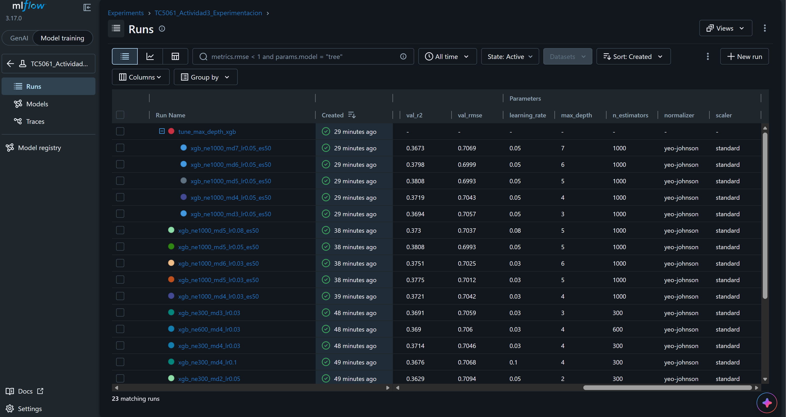
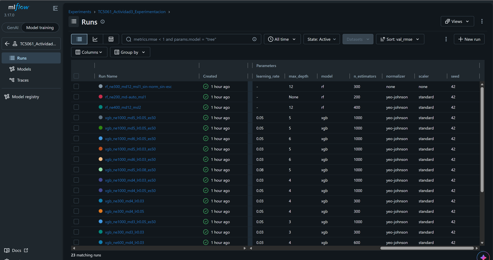
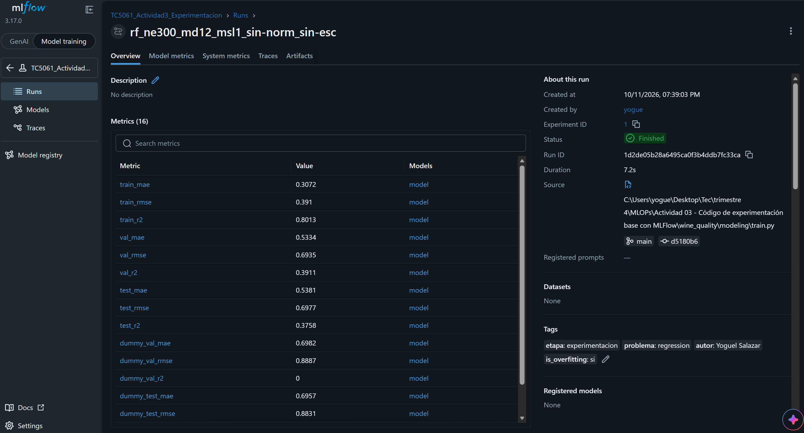
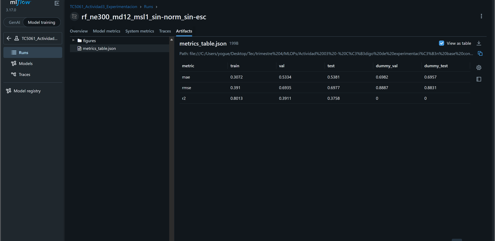
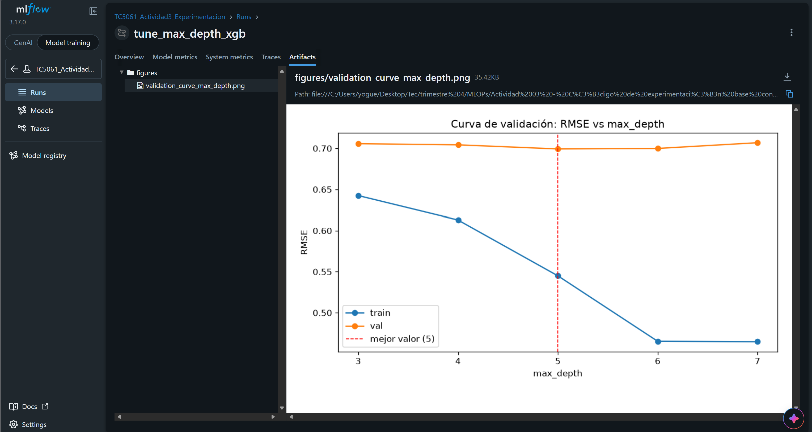

# TC5061 · Actividad 3 — Código de experimentación base con MLflow

**Alumno:** Victor Yoguel Salazar Alanis · A01797950
**Curso:** TC5061 – Operaciones de Aprendizaje Automático (MLOps) · Tecnológico de Monterrey
**Repositorio:** <https://github.com/CFOP2357/Wine-Quality>

---

## 1. Ejecución del script

El notebook de la Actividad 2 se migró al paquete `wine_quality/` (carga y partición en
`dataset.py`, preprocesamiento en `features.py`, selección de modelo en `modeling/models.py`
y entrenamiento en `modeling/train.py`); el notebook se conserva solo para el EDA. El script
corre sin argumentos (defaults: regresión lineal, semilla 42) y expone por `argparse` el
modelo, la semilla, cinco hiperparámetros de modelo, el preprocesamiento (imputación,
normalización, escalado) y el early stopping:

```
python -m wine_quality.modeling.train
python -m wine_quality.modeling.train --model rf --n-estimators 300 --max-depth 12 --normalizer none --scaler none
```

El proyecto es además un **proyecto MLflow** (`MLproject`), de modo que las mismas corridas
se lanzan con `mlflow run`, pasando los hiperparámetros con `-P`:

```
$env:MLFLOW_TRACKING_URI = "sqlite:///mlflow.db"
mlflow run . --env-manager local --experiment-name TC5061_Actividad3_Experimentacion `
    -P model=rf -P n_estimators=300 -P max_depth=12 -P normalizer=none -P scaler=none
```

Ambas vías ejecutan el mismo `train.py` y registran corridas idénticas en el experimento:
el `MLproject` declara el superset de parámetros y su comando invoca el script. Las
instrucciones completas (instalación, datos, tabla de argumentos) están en el README del
repositorio.

## 2. Experimento registrado

Todas las corridas se agrupan en el experimento **TC5061_Actividad3_Experimentacion**
(tracking local en SQLite). Cada corrida registra, dentro de un `mlflow.start_run()`: los
hiperparámetros efectivos del modelo (`log_params`), 16 métricas (`log_metric`: MAE, RMSE y R²
en train/val/test, la referencia dummy y la brecha de overfitting), artefactos
(`log_artifact`/`log_table`: figura real-vs-predicho, tabla de métricas y, con early
stopping, la curva train-vs-val por iteración) y el pipeline entrenado completo
(`mlflow.sklearn.log_model`). El proyecto tiene dos puntos de entrada: **`main`**
(`train.py`: una configuración → una corrida) y **`tune`** (*sweep*: dado UN hiperparámetro
y una lista de valores, entrena una corrida completa por valor como hijas anidadas de una
corrida padre y genera la curva de validación RMSE train/val contra ese hiperparámetro).
La experimentación se hizo **mayormente con `main`**, variando los hiperparámetros corrida
por corrida y decidiendo cada cambio con el `val_rmse` de la anterior, porque eso es
exactamente lo que pide la actividad: experimentar explícitamente con los hiperparámetros y
comparar las corridas; el sweep se usó al final, una vez, para confirmar el óptimo de
`max_depth` con una curva sistemática. El experimento contiene **23 corridas**: 7 corridas
base comparando los cuatro modelos (linear, árbol, random forest, XGBoost) y variando su
preprocesamiento, más la búsqueda de hiperparámetros de XGBoost (descenso por coordenadas
con `main`, early stopping con `eval_set` y el sweep de `max_depth`).

**Protocolo:** los modelos se compararon y seleccionaron únicamente con las métricas de
**validación**; el RMSE de **test** se reporta como estimación de generalización de la
configuración ya elegida y no participó en ninguna selección.

## 3. Evidencias (capturas de MLflow)

**Captura 1 — Tabla comparativa de corridas**, ordenadas por `val_rmse` ascendente:
la configuración campeona en la primera fila, con hiperparámetros y métricas de
validación lado a lado:



**Captura 2 — Parámetros registrados por corrida**: cada argumento de la CLI
(`model`, `n_estimators`, `max_depth`, `learning_rate`, `normalizer`, `scaler` y la
`seed`) queda como parámetro de la corrida, lo que vuelve toda configuración comparable
y reproducible desde la interfaz:



**Captura 3 — Detalle de la corrida campeona** `rf_ne300_md12_msl1_sin-norm_sin-esc`:
las 16 métricas registradas, tags y metadatos de la corrida:



**Captura 4 — Artefactos de la corrida campeona** (carpeta `figures/` y
`metrics_table.json` con las métricas por partición, incluida la referencia dummy):



**Captura 5 — Curva de validación del sweep** `tune_max_depth_xgb` descrito en la
sección 2 (RMSE train vs val contra `max_depth`; mejor valor = 5):



## 4. Análisis de resultados

**Mejor configuración.** El campeón por validación fue **Random Forest con 300 árboles,
profundidad máxima 12 y sin normalización ni escalado** (`rf_ne300_md12_msl1_sin-norm_sin-esc`):
val RMSE **0.6935**, y en test —evaluado una sola vez, ya elegido— RMSE **0.6977**, MAE 0.538 y
R² 0.376, un error claramente menor que el de la referencia trivial de predecir la media
(test RMSE 0.8831). Las
tres variantes de random forest quedaron estadísticamente empatadas (val RMSE 0.6935–0.6939),
de modo que la evidencia sostiene "random forest con ~200–400 árboles" más que una combinación
exacta. El mejor XGBoost afinado (profundidad 5, lr 0.05, 165 árboles por early stopping) quedó
cerca en validación (0.6993) — y de hecho en test rindió 0.6934, mejor que el campeón: una
inversión dentro del ruido que confirma el empate práctico entre ensambles (la selección se
mantiene por validación para no contaminar test). El lineal (0.7410) y el árbol (0.7483)
quedaron claramente atrás.

**Hiperparámetro más influyente.** La decisión que más movió las métricas fue la **familia de
modelo**: pasar de lineal/árbol a un ensamble redujo el val RMSE ~0.05 (≈7%). Dentro de XGBoost,
el hiperparámetro individual más influyente fue **max_depth**, con curva en U en el sweep
(val RMSE 0.6993 en profundidad 5 frente a 0.7057/0.7069 en los extremos 3 y 7, y 0.7094 con
profundidad 2 en la búsqueda manual), mientras `learning_rate` y `n_estimators` solo movieron
milésimas una vez fijada la profundidad con early stopping. Hallazgo adicional: quitar la
normalización y el escalado **no afectó** a los modelos de árboles (el campeón no los usa);
ese preprocesamiento beneficia a los modelos lineales.

**Sobreajuste del modelo seleccionado.** El campeón **está sobreajustado**: su RMSE de
entrenamiento (0.391) es 77% mejor que el de validación (0.6935), brecha que el script
detecta y etiqueta (`overfit_gap_pct=77.4`, `is_overfitting=si`, umbral 3%); todos los
ensambles del experimento presentan brechas de 67–172%, típicas de árboles que memorizan el
conjunto de entrenamiento. La consistencia val→test del campeón (0.6935→0.6977, +0.6%)
indica que aun así generaliza mejor que las alternativas de baja capacidad (el lineal, único
modelo con brecha <3%, rinde peor en test: ~0.74). **Lo ideal sería iterar con el sweep
(`tune`) sobre cada hiperparámetro de capacidad** (`max_depth`, `min_samples_leaf`,
`n_estimators`, y en xgb regularización) **hasta una configuración con brecha train-val
menor al 3% sin sacrificar validación**: un modelo que rinda igual sin memorizar es
preferible por robustez ante cambios en la distribución de los datos.

**Limitaciones.** La principal es la **selección de hiperparámetros**: la búsqueda fue por
coordenadas (un hiperparámetro a la vez), que puede perder interacciones entre ellos, y
sobre una única partición (semilla 42). Además de la estrategia de sweeps con restricción
de brecha descrita arriba, podrían escogerse mejor con búsqueda aleatoria o bayesiana
(Optuna) para cubrir combinaciones, y con validación cruzada para medir la varianza entre
particiones.

Desde la perspectiva de MLOps:

- **Datos:** descarga manual, sin versionado (DVC) ni validación automática de
  esquema/calidad a la entrada (tipo Great Expectations).
- **Selección y promoción:** la elección del campeón es manual; falta Model Registry con
  promoción por alias (`@champion`) y un *gate* automático que compare el candidato contra
  el modelo vigente.
- **Evaluación estática:** test es un corte fijo del dataset; en un ciclo real se refresca
  con datos recientes y se complementa con monitoreo de *drift* y evaluación continua.
- **Entorno y automatización:** sin contenedor (Docker), tracking en SQLite local (no
  compartible en equipo) y sin CI/CD ni reentrenamiento automatizado.

---

**Referencias**

Cortez, P., Cerdeira, A., Almeida, F., Matos, T., & Reis, J. (2009). *Wine Quality*
[Dataset]. UCI Machine Learning Repository. https://doi.org/10.24432/C56S3T

Salazar Alanis, V. Y. (2026). *TC5061 Actividad 2 — Notebook Baseline* [Notebook: EDA,
limpieza y modelo base migrados en esta actividad]. Disponible en el repositorio:
[`notebooks/TC5061_Notebook_Baseline_SalazarVictor.ipynb`](https://github.com/CFOP2357/Wine-Quality/blob/main/notebooks/TC5061_Notebook_Baseline_SalazarVictor.ipynb)

**Declaración de uso de IA:** Anthropic. (2026). *Claude Code (Claude Opus 5.5 y Claude Fable 5)*
[Modelo de lenguaje grande], utilizado para edición de código y gestión del repositorio bajo un
esquema *human-in-the-loop* (decisiones dirigidas, revisadas y aprobadas por el autor).
https://claude.com/claude-code
